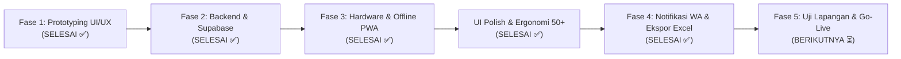

# 🗺️ Roadmap & Timeline Proyek POS Toko Berkah Garam

> Dokumen panduan fase pengerjaan sistem POS & Pembukuan Digital agar proses pengembangan terarah, efisien, dan siap pakai untuk operasional harian toko.

---

---

## 📌 Rincian 5 Fase Pengerjaan Proyek

### Fase 1: Perancangan UI/UX & Interaksi Kasir (Status: ✅ Selesai)
Fokus fase ini adalah memastikan seluruh alur kasir, tata letak mobile, dan kenyamanan pengguna di lapangan sudah teruji secara visual sebelum menyentuh arsitektur server yang rumit.

* [x] **Antarmuka Kasir Mobile & Tablet**: Segmented tab *Katalog* vs *Nota Belanja*, floating checkout bar, dan tombol sentuh besar.
* [x] **Dual Role (Mode Pemilik vs Mode Penjaga/Saudara)**: Proteksi PIN untuk menyembunyikan harga beli modal, keuntungan bersih, dan menu penarikan kas.
* [x] **Fitur Khas Grosir & Eceran Garam**: 
  * Modul *Buka Karung* (repack karung 50kg ke bungkus 1kg + hitung susut timbangan).
  * Modul *Ambil Uang* (prive, bayar operasional, upah kuli angkut).
  * Modul *Stok Multi-Gudang* (toko depan vs gudang belakang).
  * Modul *Tutup Kasir Harian* (rekonsiliasi uang fisik laci kasir).
* [x] **Modul Buku Bon & Piutang Pelanggan**: Integrasi pencatatan hutang pelanggan langsung dari kasir, kalkulasi cicilan, dan tombol tagihan WhatsApp.
* [x] **Laporan & Analitik**: Grafik Chart.js mingguan, bulanan, tahunan, serta filter tanggal kustom.

---

### Fase 2: Integrasi Backend & Database Riil (Status: ✅ Selesai)
Menggantikan mock data statis dengan Database Access Layer (`frontend/db.js`) berbasis PostgreSQL (Supabase) dengan fallback IndexedDB/localStorage otomatis.

* [x] **Skema Database Relasional Lengkap** (`database/schema.sql`):
  * 8 tabel operasional lengkap: `products`, `customers`, `transactions`, `transaction_items`, `debts`, `debt_payments`, `cash_withdrawals`, `daily_closings`.
  * Trigger otomatis pengurangan stok toko/gudang saat transaksi lunas atau bon.
* [x] **Database Access Layer (`frontend/db.js`)**:
  * Sinkronisasi data real-time via Supabase JS v2 Client.
  * Mode fallback offline lokal yang transparan tanpa error jika internet terputus.
* [x] **Modal Konfigurasi Supabase Mandiri**:
  * Tombol badge status database di top bar memungkinkan pengguna memasukkan Project URL & Anon Key tanpa menyentuh kode program.

---

### Fase 3: Fitur Hardware POS & Offline PWA (Status: ✅ Selesai)
Dukungan penuh untuk perangkat kasir fisik (printer struk dan scanner) serta instalasi aplikasi sebagai PWA.

* [x] **PWA (Progressive Web App)**:
  * Berkas `manifest.json` & ikon multi-resolusi (`frontend/icons/`) agar aplikasi dapat diinstal di homescreen Android / iOS / Windows Desktop.
  * `sw.js` (Service Worker) dengan strategi caching *stale-while-revalidate* untuk operasional offline 100%.
* [x] **Koneksi Printer Struk Thermal Bluetooth (`frontend/printer.js`)**:
  * Integrasi Web Bluetooth API untuk printer thermal 58mm / 80mm standar (ESC/POS command encoder).
  * Fitur tes cetak, pengaturan cetak struk otomatis, pemotongan teks rapi, dan fallback window print browser.
* [x] **Barcode Scanning (Kamera HP & Barcode Gun USB)**:
  * Pemindai barcode fisik via kamera (ZXing / BarcodeDetector API) di kasir.
  * Auto-listen input USB barcode scanner (pengetikan cepat diakhiri Enter).
  * Dialog penautan barcode baru ke katalog secara instan.
* [x] **Halaman Pusat Pengaturan (`frontend/pengaturan.html`)**:
  * Kontrol profil toko di nota struk, status koneksi printer Bluetooth, dan database barcode.

---

### UI Polish & Audit Responsif Antarmuka (Status: ✅ Selesai)
* [x] Layout POS modern: Desktop split screen 100vh tanpa tumpang tindih maupun scrollbar ganda.
* [x] Pembersihan total kebocoran overflow horizontal pada layar resolusi standar laptop (1366×768) dan tablet.
* [x] Header fleksibel (flex-wrap), sticky checkout bar, dan aside nota dengan scroll mandiri.

---

### Ergonomi Kasir Ramah Pengguna Lansia (Usia 50+ Tahun) (Status: ✅ Selesai)
Penyesuaian khusus seluruh komponen kasir agar operator berusia senior dapat mengoperasikan aplikasi tanpa rasa bingung, tanpa takut salah klik, dan tanpa beban hitung di kepala:
* [x] **Pemisahan Tegas Pembayaran Tunai vs Transfer Bank / QRIS**:
  * Tombol metode pembayaran kontras tinggi: **TUNAI (CASH)** [Hijau], **TRANSFER / QR** [Biru], **BUKU BON** [Kuning Amber].
* [x] **Modal Tunai Tanpa Pusing Hitung**:
  * Angka tagihan & kembalian berukuran raksasa (24px - 32px font bold).
  * 4 Tombol Cepat Pecahan Uang Pembeli (*Uang Pas*, *50.000*, *100.000*, *200.000*) untuk otomatisasi perhitungan uang kembalian instan.
* [x] **Modal Transfer / QRIS Anti-Keliru**:
  * Nomor rekening toko (BCA / Mandiri / BRI / QRIS) ditampilkan dalam kotak jelas dilengkapi tombol **Salin 1-Klik** untuk memudahkan kirim ke WA pembeli.
  * Pilihan Bank Pengirim pembeli yang jelas dan mudah dipilih.
  * Pengingat keamanan: *"Pastikan SMS / Notifikasi Mutasi Masuk Sebelum Barang Dibawa"*.
  * Uang transfer dicatat ke akun bank toko (bukan kas laci fisik), sehingga rekonsiliasi uang fisik laci di modul **Tutup Kasir Harian** tetap akurat dan tidak selisih.
* [x] **Modal Buku Bon & Pembayaran Cicilan Ramah Lansia**:
  * Input nominal besar, tombol cepat lunasi/cicil separuh, dan kalkulasi otomatis sisa hutang tanpa kalkulator manual.

---

### Fase 4: Otomatisasi Notifikasi WhatsApp & Cadangan Excel (.xlsx) (Status: ✅ Selesai)
Memastikan pemilik toko memiliki visibilitas penuh terhadap arus uang harian serta kemudahan penagihan piutang dan pencadangan data:

* [x] **Notifikasi Tutup Shift ke WhatsApp Pemilik (`frontend/tutup-kasir.html`)**:
  * Rekap harian lengkap otomatis tersusun rapi: modal awal pagi, penjualan tunai laci, pengeluaran kas, uang fisik laci terhitung, uang masuk transfer bank, dan status rekonsiliasi (*PAS / LEBIH / KURANG*).
  * Tombol 1-klik **Kirim Laporan ke WhatsApp Pemilik** langsung membuka WhatsApp dengan format pesan profesional dan siap kirim.
  * Opsi salin teks laporan untuk paste manual di WhatsApp Web.
* [x] **Format Tagihan WhatsApp Ramah & Sopan (`frontend/buku-bon.html`)**:
  * Format pesan WhatsApp penagihan bon otomatis merinci barang yang diambil, total belanja, cicilan yang sudah masuk, sisa hutang, tanggal janji bayar, dan nomor rekening toko untuk transfer.
  * Otomatisasi format nomor telepon internasional Indonesia (`628xx`).
  * Opsi salin pesan jika pelanggan belum memiliki nomor telepon di sistem.
* [x] **Ekspor Multi-Sheet Spreadsheet Excel (.xlsx) (`frontend/laporan.html`)**:
  * Integrasi pustaka **SheetJS (XLSX)** untuk mengekspor file spreadsheet `.xlsx` asli dengan 4 lembar kerja (Sheet):
    1. *Ringkasan*: Omzet, keuntungan laba kotor/bersih, total transaksi, barang terlaris.
    2. *Daftar Transaksi*: No invoice, tanggal/jam, nama pelanggan, metode bayar, detail item, total omzet, kas masuk.
    3. *Stok & Aset*: ID produk, kategori, satuan, stok toko, stok gudang, modal, harga jual, dan total nilai aset modal.
    4. *Buku Bon*: Data pelanggan berhutang, sisa bon, status, dan riwayat cicilan.
  * Mekanisme *fallback* otomatis ke berkas UTF-8 CSV jika beroperasi offline tanpa pustaka SheetJS.
* [x] **Pencadangan (Backup) & Pemulihan (Restore) JSON Mandiri (`frontend/laporan.html`)**:
  * Tombol 1-klik untuk mengunduh salinan lengkap database offline dalam format `.json` yang siap disimpan di Google Drive pribadi pemilik.
  * Fitur *Restore* untuk memulihkan seluruh data toko kapan saja jika berganti perangkat/komputer.

---

### Fase 5: Uji Coba Lapangan (Pilot Test) & Peluncuran Resmi (Target: Minggu 5)
Tahap implementasi nyata di toko garam untuk menguji kebiasaan staf dan kestabilan sistem.

* **Target Output**:
  1. **Simulasi Transaksi Paralel (3-5 Hari)**:
     * Toko tetap menjalankan nota manual sambil paralel menginput ke sistem digital untuk menguji apakah ada selisih atau kendala lambat.
  2. **Pelatihan Staf & Saudara (Mode Penjaga)**:
     * Memastikan penjaga toko lancar melayani kasir, menambah barang, dan melayani pembayaran bon tanpa bingung.
  3. **Go-Live Resmi**:
     * Transisi penuh dari nota kertas ke sistem digital.
     * Monitor harian selama minggu pertama operasional.

---

## 📊 Matriks Prioritas Kerja (Urutan Pengerjaan)

| No | Modul / Tugas | Tingkat Urgensi | Kompleksitas | Estimasi |
| :---: | :--- | :---: | :---: | :---: |
| 1 | Database Setup (Supabase / SQLite) & Sinkronisasi API | 🔴 **Sangat Tinggi** | Sedang | 3-5 Hari |
| 2 | Cetak Nota Struk Thermal Bluetooth (58mm) | 🔴 **Sangat Tinggi** | Rendah - Sedang | 2-3 Hari |
| 3 | PWA Offline-First (Bisa dipakai saat offline) | 🟡 **Tinggi** | Sedang | 3-4 Hari |
| 4 | Ekspor Laporan Excel (.xlsx) & Backup Data | 🟡 **Tinggi** | Rendah | 1-2 Hari |
| 5 | Integrasi Notifikasi WhatsApp Gateway | 🟢 **Sedang** | Sedang | 2-3 Hari |
| 6 | Uji Coba Operasional & Penyesuaian Toko | 🟢 **Sedang** | Rendah | 3-5 Hari |

---

## 🎯 Rekomendasi Langkah Selanjutnya

Untuk melanjutkan pekerjaan berikutnya secara terarah, langkah yang disarankan adalah **memulai Fase 2**:
1. Menentukan arsitektur backend yang ingin digunakan:
   * **Opsi A (Paling Cepat & Gratis)**: Menggunakan **Supabase** (Database cloud PostgreSQL gratis, real-time sync, auth aman, tanpa perlu repot sewa VPS).
   * **Opsi B (Lokal Mandiri)**: Menggunakan **Node.js / Python FastAPI + SQLite** jika ingin sistem berjalan offline sepenuhnya di 1 komputer kasir toko.
